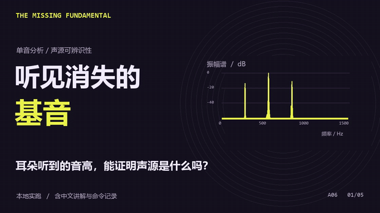

# 听见消失的基音

耳朵听到的音高，能证明声源是什么吗？

[](demo/demo.mp4)
[播放或下载 49 秒中文演示](demo/demo.mp4) · [查看真实终端记录](demo/transcript.txt)

0:00 研究问题 · 0:06 实际输入 · 0:16 运行与结果 · 0:27 追问与反例 · 0:39 复演与适用边界

## 自己跑一次

在仓库根目录运行以下命令。需要 Python 3.10 或更新版本，演示仅依赖标准库。每一步可独立执行。

```shell
python demo/run.py input
python demo/run.py run
python demo/run.py challenge
```

使用了 `harmonic-pitch-trace/scripts/analyze.py`。分清默认的声学重复频率和 `--source-identity` 对潜在声源的判断。 如果要直接调用研究脚本，可运行以下命令。

```shell
python harmonic-pitch-trace/scripts/analyze.py harmonic-pitch-trace/assets/case2.wav --out case2-result.json
python harmonic-pitch-trace/scripts/analyze.py demo/twin-360.wav --source-identity --out twin-result.json
```

## 已测结果与边界

本次 `case2.wav` 得到 277.302 Hz。360 Hz 同波形反例给出 360.3 与 180.2 Hz 两个候选，状态为 `source_not_identifiable`。在另一个 50 组合成困难留出集上，严格模式接受 3 组，接受样本内的倍频错误为 0，47 组拒判。

严格模式保留两种候选。样例来自确定性合成；和弦及真实乐器需要外部验证。

[实际输入 WAV](harmonic-pitch-trace/assets/case2.wav) · [同波形反例](demo/twin-360.wav) · [严格模式测试报告](测试报告.md)

## 数据与演示素材

试听来自本仓随附的原创合成 WAV。第二段纯音由 8 kHz、16 位整型 PCM 生成。视频播放这两段输入，保留原始音高，重复播放便于听辨。 视频中的命令已在本地 Python 环境实际执行；动画按输出分步显示，中文配音由本机离线语音合成。项目演示采用仓库脚本。

[作品说明](作品说明.md) · [测试报告 PDF](测试报告.pdf) · [Skill 使用说明](harmonic-pitch-trace/SKILL.md) · [研究海报](海报.pdf) · [答辩 PPT](答辩.pptx)


[下载独立 Skill ZIP](harmonic-pitch-trace.zip)


[下载 80 × 200 cm 印刷海报 PDF](海报.pdf) · [下载 300 dpi 海报 JPG](海报.jpg)
