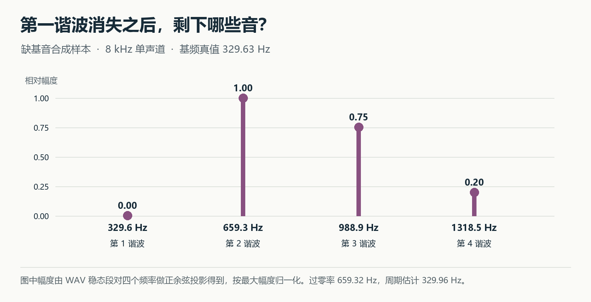

# 听见消失的基音

## 1.1 版使用说明 · 声学重复频率与声源音高分开判定

分析 WAV 的声学重复频率时使用原命令。若问题指向乐器真实演奏音或缺失基音的潜在来源，追加 --source-identity，并保留所有候选和拒判原因。不要用跨窗稳定给潜在来源作唯一归因。

在 5 个加 Hann 窗的片段内比较候选频率的半整数分音与整数分音振幅，结合相邻频带的本底估计决定是否拒判。中位比值超过 max(0.005, 4×本底比值) 时返回 octave_ambiguous。严格模式对支持范围内无法从波形区分的整数次缺基音解释返回 source_not_identifiable。

原 36 组中，旧版接受 36 个并发生 2 次稳定倍频错报。新版默认接受 34 个、拒判 2 个，接受集内无倍频错误。60 组弱奇次谐波挑战用于调试噪声门限，旧版接受 60 个、40 次倍频错误，新版默认接受 21 个、1 次错误；严格声源模式接受 20 个、0 次错误。

360 Hz 正弦与 180 Hz 源只留下第二谐波能生成逐字节相同的 PCM。严格模式对该文件拒判并列出候选。潜在声源判断依赖 130–500 Hz 的频带先验和整数谐波假设；未做真实乐器外部验证。

```console
python harmonic-pitch-trace/scripts/analyze.py harmonic-pitch-trace/assets/case3.wav --source-identity --out source.json
```

新版实验逐项输入或生成参数、逐项结果和验收摘要见 `复核实验/results.json`。下文的原始样例、海报与原 36 组实验记录标为 1.0 版证据。原三组配对与边界用例已在新版默认入口复跑；Mira 桌面端的模型对照仍待实际采集。


从谐波间隔恢复单音乐音的基频 ｜ 音乐声学 · 数字信号处理 ｜ Mira A 玩法

## 为什么会听高一个八度

乐器音色常有强于基音的高次分音。以波形穿过零点的次数估计频率，在干净正弦音上非常准；碰到谐波丰富的音色，则可能多报一个八度。作品将每个音频样本做成可听、可查参数的小实验。

**研究问题**　当最响的分音高出一个八度，录音里仍能找回演奏音高吗？

**适用场景**　音乐科技教学中分析稳态乐器单音、比较音色导致的音高估计误差。

## 作品如何运转

取 60 ms 定长窗，在固定比较长度上计算各延时的平方差。用延时 1 至当前延时的差分平均值归一化，找首个低于 0.15 的局部谷，三点抛物线细化周期。12 窗至少 8 窗有效且跨窗跨度不超过 70 音分，才取中位数。全部阈值是本实现参数。

**输入。** 输入单声道 16 位有符号小端 PCM WAV，采样率 4–48 kHz、时长 0.12–15 s，目标基频 130–500 Hz。可直接播放 assets 中 0.5 秒、8 kHz 的音频，或运行项目外层的 audio_fixtures.py 重新合成。

**输出。** JSON 给出 12 个窗起点 starts_s、各窗估计 frame_hz、通过数和状态。steady 时给出 fundamental_hz 与 spread_cents，静音或有效窗不足返回 insufficient，跨度过大返回 unstable。



329.63 Hz 合成音移除了第一谐波。上行过零率指向 659.32 Hz，周期差分给出 329.96 Hz。

## 在 Mira 桌面端使用

从 [Mira 官网](https://mira.deepprinciple.com/) 获取桌面端。将本作 Skill 源目录导入该版本支持的 Skill 管理入口；若选择 GitHub 导入，先准备含本作的真实参赛者仓库。在全新对话中提供 `case1.wav` 并发出下列任务。

> 请分析这个 WAV 的基频，报出通过门限的窗数与音分跨度。再对静音运行一次并说明为什么没有音高。

桌面端可运行 Python 时，要求显示工具调用、读取产生的 JSON 并解释核心字段。若仅返回自然语言，核对是否实际触发本 Skill、脚本是否可运行以及输入路径是否可读。本地离线复核从本作品根目录运行：

```console
python harmonic-pitch-trace/scripts/analyze.py harmonic-pitch-trace/assets/case1.wav --out result.json
python benchmark.py --out reproduced.json
python stress.py --out supplementary.json
```

## 软件、硬件与数据

核心运行环境为 Python 3.10+ 标准库，单 CPU，离线，无外部包和 GPU 依赖。本地对照实测于 Windows AMD64、Intel Core Ultra 7 265KF、CPython 3.11.9。Mira 端版本、模型和运行记录由参赛者完成正式测试时登记。

全部录音均为样本发生器合成，无外部录音和表演者。渐入渐出各 25 ms，振幅与谐波参数写在 audio_fixtures.py 中。

## 验收标准

1. 读取 PCM 头并检查时长、声道和采样位数。
2. 每段音有可定位的 12 个窗，未达门限的窗保留空值。
3. 三组稳态样本的 |1200 log₂(估计值/真值)| 均小于 10 音分。
4. 纯静音应产生 0 个有效窗且状态为 insufficient。

整体交付以 3 组配对计算和 1 个边界判定能从附件复跑，并能从结果追溯到原始试听卡为准。Mira 端另验收成功触发、可见工具结果和答案解释，测试方法见《测试报告》。

## 结果与适用边界

196 Hz 纯音的误差为 0.46 音分，过零率为 0.08。 二谐波更强时误差 0.76 音分，过零率约高 1 个八度。 缺基音时恢复 329.96 Hz，距 329.63 Hz 真值 1.72 音分。 36 组合成音在 145–445 Hz 均匀抽取基频，随机改变第一、三谐波幅度，并加入小幅均匀噪声。算法对 36 组均给出了稳态估计，34 组在 10 音分以内。第 29、30 组的奇次谐波弱，误差分别达 1205.87 和 1207.36 音分。两例说明跨窗稳定不足以排除一个八度的系统误判。

面向 130–500 Hz 的稳态单音。和弦、滑音、整段只有偶次谐波或严重混响时，结果可能拒判或出现八度错误。

时延归一化方法参考 [de Cheveigné 与 Kawahara 的 YIN 论文](https://pubmed.ncbi.nlm.nih.gov/12002874/)。程序独立实现其核心思想。

## 作者与提交信息

姓名、学校、主页及实际贡献由真实参赛者填写。GitHub 用户名或队名请同步写入 SKILL.md 的 metadata.author，当前 pending-owner 为预留值。技能目录采用 MIT 授权，公开前由实际作者确认授权与署名。A 玩法按赛务指引在飞书和 GitHub 双线提交，GitHub 每项作品单独发起 PR。
