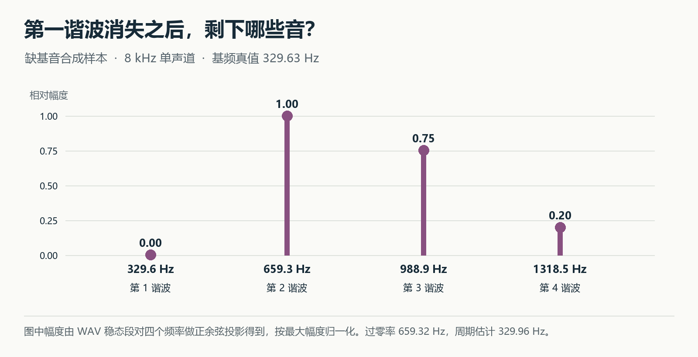

# 听见消失的基音 · 测试报告

## 1.1 版复核实验 · 声学重复频率与声源音高分开判定

在 5 个加 Hann 窗的片段内比较候选频率的半整数分音与整数分音振幅，结合相邻频带的本底估计决定是否拒判。中位比值超过 max(0.005, 4×本底比值) 时返回 octave_ambiguous。严格模式对支持范围内无法从波形区分的整数次缺基音解释返回 source_not_identifiable。

原 36 组中，旧版接受 36 个并发生 2 次稳定倍频错报。新版默认接受 34 个、拒判 2 个，接受集内无倍频错误。60 组弱奇次谐波挑战用于调试噪声门限，旧版接受 60 个、40 次倍频错误，新版默认接受 21 个、1 次错误；严格声源模式接受 20 个、0 次错误。

另设 50 个低信噪、弱奇次或零奇次谐波留出条件，采用新的种子，未用于选择门限。在合成声源真值下，默认接受 38 个，其中 35 个与声源差约一倍频。严格模式仅接受 3 个，拒判 47 个，接受集内无错。覆盖率低是区分物理声源时的明确代价。

360 Hz 正弦与 180 Hz 源只留下第二谐波能生成逐字节相同的 PCM。严格模式对该文件拒判并列出候选。潜在声源判断依赖 130–500 Hz 的频带先验和整数谐波假设；未做真实乐器外部验证。

```console
python -B 复核实验/replay.py --out review.json
```

新版实验逐项输入或生成参数、逐项结果和验收摘要见 `复核实验/results.json`。下文的原始样例、海报与原 36 组实验记录标为 1.0 版证据。原三组配对与边界用例已在新版默认入口复跑；Mira 桌面端的模型对照仍待实际采集。


## 从纯音到缺基音的听辨实验

研究问题是“当最响的分音高出一个八度，录音里仍能找回演奏音高吗？”本次实验对照的是 Skill 所调用的本地算法与下述无 Skill 流程。Mira 桌面端的模型行为仍待单独采集，记录办法附在文末。

去除整段直流均值，数均值上穿时刻，用首末上穿的间距计算基本过零频率。它在正弦音上误差极小，也能暴露谐波丰富时的倍频现象。真值直接来自振荡器频率参数。

**评价指标。** 绝对音高误差（音分，低为优）。保留原始有符号估计，误差取绝对值。

| 任务及输入 | 合成真值 | 过零率 / Hz | 误差（过零 → 周期；音分） |
| --- | --- | --- | --- |
| 纯音 · `case1.wav` | 196.00 Hz | 196.01 | 0.08 → 0.46 |
| 二谐波强 · `case2.wav` | 277.18 Hz | 554.36 | 1199.99 → 0.76 |
| 缺失基音 · `case3.wav` | 329.63 Hz | 659.32 | 1200.15 → 1.72 |

- **任务 1**　196 Hz 纯正弦，谐波系数 [1]。
- **任务 2**　277.18 Hz 的前三次谐波系数 [0.22,1,0.30]。
- **任务 3**　329.63 Hz 的前四次谐波系数 [0,1,0.75,0.20]。



## 边界与失败案例

静音文件得到 insufficient，12 个窗全部拒判。纯音任务中上行过零率更精确。缺基音恢复依赖剩余谐波间距，若只留下第二、第四谐波，波形也能解释为另一个音。

## 扩展实验

36 组合成音在 145–445 Hz 均匀抽取基频，随机改变第一、三谐波幅度，并加入小幅均匀噪声。算法对 36 组均给出了稳态估计，34 组在 10 音分以内。第 29、30 组的奇次谐波弱，误差分别达 1205.87 和 1207.36 音分。两例说明跨窗稳定不足以排除一个八度的系统误判。

完整样本参数、逐项结果及随机种子在 `扩展实验.json`。脚本 `stress.py` 重新生成同一批样本并通过 Skill 的真实命令行入口逐一运行。

## 复现实验

```console
python benchmark.py --out reproduced.json
python stress.py --out supplementary.json
```

三组主对照及边界用例在 `harmonic-pitch-trace/assets/`。结果保存在 `原始结果.json` 的 records 中，skill_output 对应完整算法输出，evaluation 保存独立基线、指标及真值。更换输入时应重新核对适用条件与评价目标。

## Mira 桌面端复测卡

每组使用同一模型与参数、同一原始文件、同一条任务提示，各开两个全新对话。一个启用本 Skill，另一个停用本 Skill。两组均可使用桌面端正常提供的其余工具。输入不附带测试报告、真值或输出 JSON。依次提供 `case1.wav`、`case2.wav`、`case3.wav`，分别要求：

> 估计单音基频 Hz。如果录音无法稳定定音请说明。

记录桌面端版本、模型、时间、是否触发 Skill、原始回复和工具输出，按上表同一判据评分。若无 Skill 的对话自行写出等价算法且取得相同结果，记录平局。三组可再交换执行次序复跑，检查结论是否对模型变动敏感。
